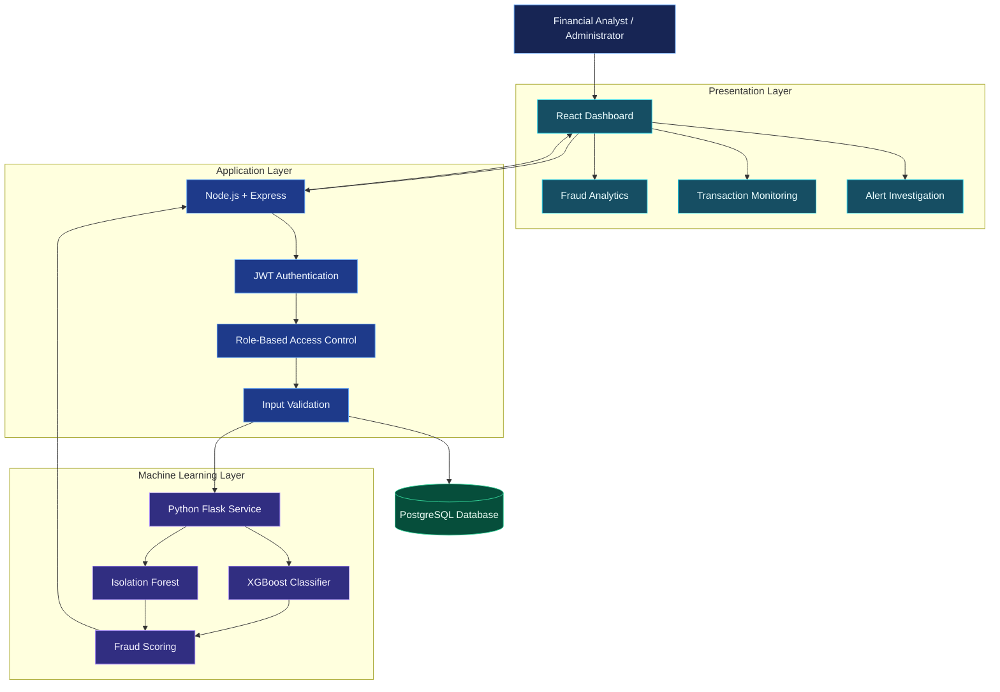
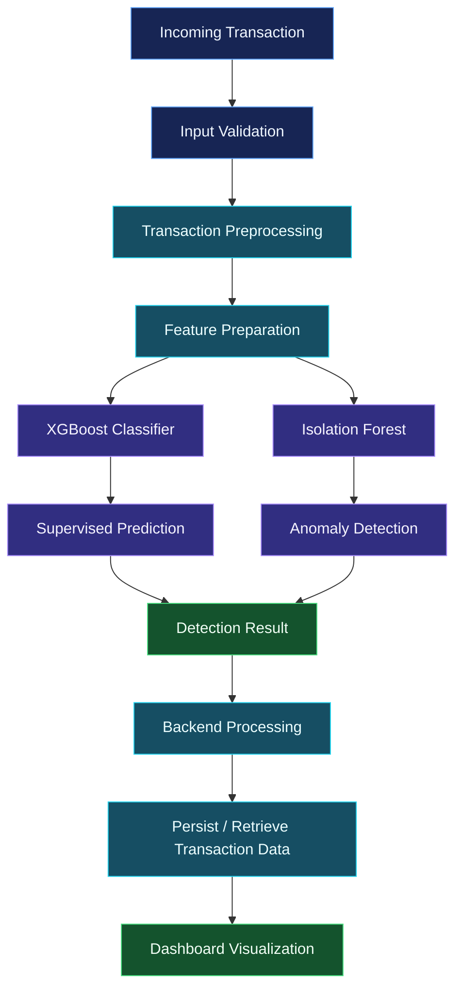
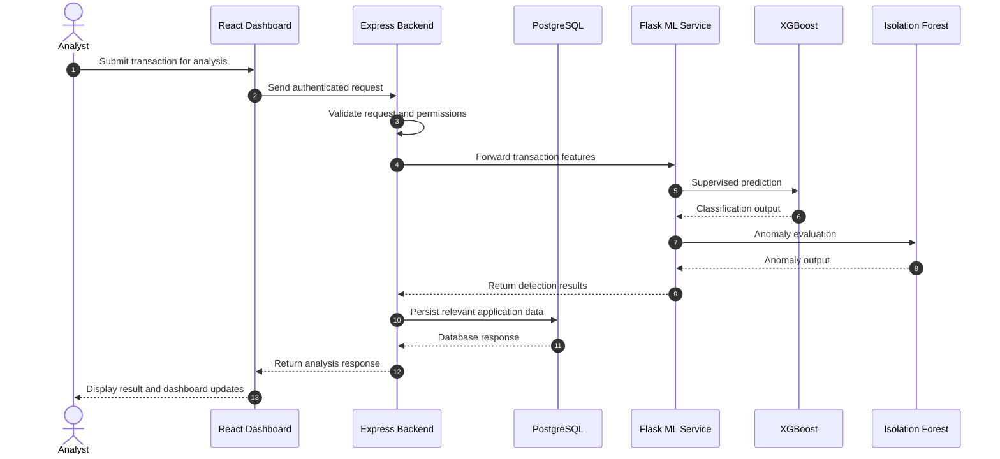

# 🛡️ Fraud Detection System
### AI-Powered Financial Fraud Detection Platform

<p align="center">
  
</p>

<p align="center">
  
  
  
  
  
</p>

<p align="center">
  <b>A full-stack financial fraud detection platform combining supervised machine learning, anomaly detection, secure REST APIs, and an interactive analytics dashboard.</b>
</p>

<p align="center">
  <a href="#-overview">Overview</a> •
  <a href="#-architecture">Architecture</a> •
  <a href="#-detection-engine">Detection Engine</a> •
  <a href="#-features">Features</a> •
  <a href="#-technology">Technology</a> •
  <a href="#-setup">Setup</a>
</p>

---

## `~/overview` — Why This Project?

Financial transactions generate large volumes of data, making suspicious activity difficult to identify through manual monitoring alone.

Traditional rule-based approaches can struggle with evolving transaction patterns and unusual behavior. A fraud detection system needs to evaluate transaction characteristics, identify anomalies, and make risk information accessible to the people investigating them.

**Fraud Detection System** explores this problem through a full-stack application that combines machine learning with backend services and a React-based analytics interface.

The platform processes **20,000+ synthetic financial transactions** through an end-to-end detection pipeline.

### Project highlights

| Capability | Implementation |
|---|---|
| Transaction processing | 20,000+ synthetic transactions |
| Supervised detection | XGBoost |
| Anomaly detection | Isolation Forest |
| Backend services | Node.js, Express.js |
| ML inference service | Python, Flask |
| Database | PostgreSQL |
| Frontend | React.js |
| API layer | 10+ RESTful APIs |
| Security | JWT, bcrypt, RBAC, input validation |

---

## `~/architecture` — System Design

The application separates the user interface, backend application services, database persistence, and machine learning inference.

### High-level architecture



### Component responsibilities

| Component | Responsibility |
|---|---|
| React frontend | Dashboard, transaction monitoring, and investigation workflows |
| Express backend | Application APIs and request orchestration |
| Authentication layer | JWT-based authentication |
| Authorization layer | Role-based access control |
| Flask service | Machine learning inference |
| XGBoost | Supervised fraud classification |
| Isolation Forest | Unsupervised anomaly detection |
| PostgreSQL | Persistent relational data storage |

---

## `~/detection_engine` — Machine Learning Pipeline

The detection engine combines two complementary approaches to identify potentially fraudulent financial activity.

### 01. XGBoost — Supervised Learning

XGBoost is used to learn patterns from labeled transaction data and classify transactions based on learned relationships between transaction features and fraud labels.

Its role in the system is to provide a supervised prediction based on patterns observed during model training.

### 02. Isolation Forest — Anomaly Detection

Not every unusual transaction necessarily matches a previously observed fraud pattern.

Isolation Forest provides an additional anomaly-detection approach by identifying observations that differ from the broader transaction distribution.

This complements supervised classification by introducing an unsupervised perspective.

### Detection workflow



> **Important:** The two models represent complementary detection techniques. Their exact score-fusion strategy, thresholds, feature transformations, and decision rules should be documented from the implemented inference code rather than assumed.

---

## `~/features` — Application Capabilities

### 01 / Transaction Processing
- Processes a dataset containing 20,000+ synthetic financial transactions.
- Supports an end-to-end transaction analysis workflow.
- Connects transaction data with the machine learning detection pipeline.

### 02 / Machine Learning Detection
- XGBoost-based supervised classification.
- Isolation Forest-based anomaly detection.
- Python Flask service for model integration.
- Fraud scoring and alert generation.

### 03 / Secure Backend APIs
- 10+ RESTful APIs.
- JWT-based authentication.
- bcrypt password hashing.
- Role-based access control.
- Input validation for application requests.

### 04 / Analytics Dashboard
- React-based analytics interface.
- Transaction monitoring.
- Fraud-related metrics and visualizations.
- Alert investigation workflows.

### 05 / Relational Data Management
- PostgreSQL integration.
- Structured storage for application data.
- Backend database communication.

---

## `~/request_lifecycle` — Transaction Analysis Sequence



*This sequence illustrates the documented component responsibilities. Exact request payloads, response fields, and persistence behavior depend on the implementation.*

---

## `~/security` — Application Security

Security is particularly important when building systems that process financial transaction information.

| Mechanism | Purpose |
|---|---|
| JWT | Authenticated application access |
| bcrypt | Password hashing |
| RBAC | Role-based authorization |
| Input validation | Validate incoming application data |
| REST API separation | Separate frontend and backend responsibilities |

### Security considerations

- Keep authentication secrets outside source control.
- Never expose database credentials or private keys in frontend code.
- Validate authorization on the backend, not only in the UI.
- Validate transaction inputs before passing them to the ML service.
- Avoid logging passwords, tokens, or sensitive financial information.
- Use HTTPS for deployed application communication.

---

## `~/technology` — Technology Stack

| Domain | Technologies |
|---|---|
| Frontend | React.js |
| Backend | Node.js, Express.js |
| ML Service | Python, Flask |
| Supervised ML | XGBoost |
| Anomaly Detection | Isolation Forest |
| Database | PostgreSQL |
| Authentication | JWT |
| Password Security | bcrypt |
| API Architecture | REST |

---

## `~/engineering_decisions` — Design Rationale

| Decision | Engineering reasoning |
|---|---|
| React dashboard | Provides an interactive interface for monitoring and investigation |
| Express backend | Centralizes application APIs and request handling |
| Separate Flask service | Keeps Python ML inference independent from the Node.js application |
| XGBoost | Supports supervised classification of transaction patterns |
| Isolation Forest | Adds an unsupervised anomaly-detection approach |
| PostgreSQL | Provides relational persistence |
| JWT + RBAC | Supports authenticated and role-controlled access |

---

## `~/setup` — Local Development

The repository's exact directory structure, dependency files, environment variable names, and startup scripts need to be matched to the source code before these commands can be treated as a verified installation guide.

### Prerequisites

- Node.js and npm
- Python 3.x
- PostgreSQL
- Git

### 1. Clone the repository

```bash
git clone <YOUR_REPOSITORY_URL>
cd <YOUR_REPOSITORY_DIRECTORY>
```

### 2. Backend setup

Navigate to the actual Node.js backend directory:

```bash
cd <BACKEND_DIRECTORY>
npm install
```

Configure the backend environment using the variable names expected by the application.

Example configuration categories:

```env
PORT=<BACKEND_PORT>
DATABASE_URL=<POSTGRESQL_CONNECTION_STRING>
JWT_SECRET=<YOUR_SECRET>
```

Start the backend using the script defined in its `package.json`.

```bash
npm start
```

### 3. Machine learning service setup

Navigate to the Flask service directory:

```bash
cd <ML_SERVICE_DIRECTORY>
```

Create and activate a virtual environment:

```bash
python -m venv venv
```

Windows:

```bash
venv\Scripts\activate
```

Install the project's Python dependencies:

```bash
pip install -r requirements.txt
```

Start the Flask application using its actual entry-point file.

```bash
python <FLASK_ENTRY_FILE>.py
```

### 4. Frontend setup

Open another terminal and navigate to the React application:

```bash
cd <FRONTEND_DIRECTORY>
npm install
npm run dev
```

Open the local URL printed by the frontend development server.

> Replace the directory names, environment variables, and startup commands above with the actual values from the repository before publishing this README.

---

## `~/roadmap` — Future Engineering Improvements

The following are potential enhancements, not claims about existing functionality.

- [ ] Add automated backend and ML API tests.
- [ ] Document model evaluation with precision, recall, F1-score, and ROC-AUC.
- [ ] Add model versioning and reproducible training configurations.
- [ ] Improve explainability of individual fraud predictions.
- [ ] Add transaction-level audit history.
- [ ] Introduce monitoring for model performance and data drift.
- [ ] Add structured API documentation.
- [ ] Improve deployment configuration and operational observability.

---

## `~/engineering_notes` — Important ML Considerations

Fraud detection is an imbalanced classification problem. Accuracy alone can hide poor fraud detection performance.

A stronger evaluation should report:

| Metric | What it measures |
|---|---|
| Precision | How many transactions flagged as fraud were actually fraudulent |
| Recall | How many actual fraudulent transactions were detected |
| F1-score | Balance between precision and recall |
| ROC-AUC | Ranking ability across classification thresholds |
| Confusion Matrix | True positives, false positives, true negatives, and false negatives |

The cost of a false negative may be significantly different from the cost of a false positive. Threshold selection should therefore reflect the intended investigation workflow.

**Dataset note:** The 20,000+ transaction figure refers to synthetic data as documented for this project. It should not be interpreted as real banking transaction volume or evidence of production financial deployment.

---

## `~/author` — Project Information

**Project:** Fraud Detection System – AI-Powered Financial Fraud Detection Platform  
**Category:** Full-Stack Development · Machine Learning · FinTech  
**Developer:** Sarthak Tanpure  
**Institution:** Pravara Rural Engineering College

<p align="center">
  <b>Building systems that turn data into meaningful decisions.</b>
</p>

<p align="center">
  
</p>